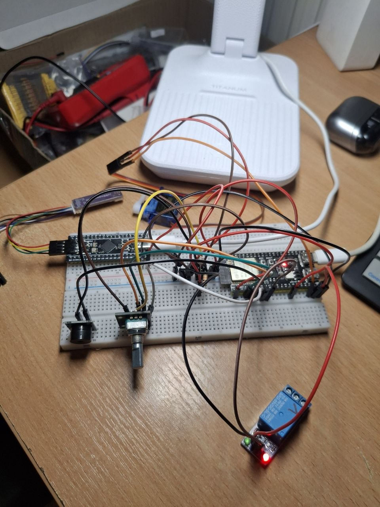

# ESP32-S3 Mini-Project (ESP-IDF / PlatformIO)

Модульний firmware-проєкт для **ESP32-S3** на базі **ESP-IDF 6.0.1** (PlatformIO), що реалізує рефакторинг базового контролера LDR → Servo та три інтерактивні задачі з ротаційним енкодером KY-040, сервоприводом, бузером і реле.

## Збірка на макетній платі



## Архітектура проєкту

```text
src/
├── app_config.h             # Піни, параметри периферії та вибір ACTIVE_TASK
├── main.c                   # Точка входу (маршрутизація активного завдання)
├── utils/
│   └── math_utils.h         # math_clamp, math_map, console_overwrite_token (\b)
├── drivers/
│   ├── servo.h / servo.c    # LEDC (Timer 0, 50 Гц, 12-біт) + контроль меж кута
│   ├── ldr.h / ldr.c        # ADC1 Oneshot + curve_fitting + SMA-фільтр (вікно 8)
│   ├── buzzer.h / buzzer.c  # LEDC (Timer 1, 10-біт) — тони та мелодії
│   └── encoder.h / encoder.c# Апаратний квадратурний PCNT + антибрязкіт SW + Queue
└── tasks/
    ├── task_ldr_servo.*     # Завдання 1: Рефакторинг LDR -> Servo
    ├── task_encoder_servo.* # Завдання 2: Керування сервоприводом енкодером
    ├── task_safe.*          # Завдання 3: Електронний сейф (PIN, 3 спроби, реле)
    └── task_calculator.*    # Завдання 4: Консольний калькулятор з \b
```

## Що покращено при рефакторингу (Завдання 1)

- Виправлено макрос періоду ШІМ (`SERVO_PERIOD_US`) та формулу розрахунку `duty` через `uint64_t` без втрати точності від цілочисельного ділення.
- Монолітний `main.c` розділено на незалежні драйвери та модулі задач без глобальних змінних.
- Додано перевірку `esp_err_t` при зчитуванні АЦП та кільцевий **SMA-фільтр** для усунення тремтіння сервоприводу.
- Сервопривід (`LEDC_TIMER_0`) і бузер (`LEDC_TIMER_1`) рознесені на різні апаратні таймери.
- Вивід логів переведено на `ESP_LOGI`/`ESP_LOGW` із коректними специфікаторами `<inttypes.h>`.

## Підключення периферії (ESP32-S3-DevKitC-1)

| Компонент | Контакт | Пін ESP32-S3 | Живлення / Примітка |
|---|---|---|---|
| **Фоторезистор (LDR)** | Середня точка дільника | `GPIO 9` (`ADC1_CH8`) | `3.3 В`, підтяжка на `GND` через `10 кОм` |
| **Сервопривід** | Сигнал PWM | `GPIO 14` | `5 В` (силова шина), спільна `GND` |
| **Енкодер KY-040** | `CLK` / `DT` / `SW` | `GPIO 4` / `GPIO 5` / `GPIO 6` | `3.3 В`, внутрішній pull-up |
| **Пасивний бузер** | Сигнал PWM | `GPIO 15` | Послідовно через струмообмежувальний резистор `220 Ом` |
| **Реле / індикатор замка** | `IN` | `GPIO 16` | Полярність задається через `RELAY_ACTIVE_LEVEL` |

## Збірка та запуск

1. У файлі `src/app_config.h` встановіть потрібний режим у `#define ACTIVE_TASK`:
   - `TASK_LDR_SERVO`
   - `TASK_ENCODER_SERVO`
   - `TASK_SAFE`
   - `TASK_CALCULATOR`
2. Прошийте плату та відкрийте монітор:
   ```bash
   pio run -t upload && pio device monitor
   ```

## Результати виконання на ESP32-S3

### 1. Рефакторинг LDR → Servo (`TASK_LDR_SERVO`)
- Протестовано на макетній платі: сервопривід плавно змінює кут у межах `10°–170°` відповідно до освітлення на фоторезисторі без джиттеру завдяки кільцевому SMA-фільтру.

Приклад виводу консолі (`115200 8-N-1`, перехід: кімнатне світло → затемнення рукою → підсвічування):
```text
I (305) task_ldr_servo: LDR -> Servo controller started (SMA window=8)
I (310) task_ldr_servo: Raw=1850 | Filtered=1400 mV | Angle= 83 deg
I (410) task_ldr_servo: Raw=1862 | Filtered=1405 mV | Angle= 83 deg
I (510) task_ldr_servo: Raw= 920 | Filtered=1170 mV | Angle= 70 deg
I (610) task_ldr_servo: Raw= 310 | Filtered= 937 mV | Angle= 58 deg
I (710) task_ldr_servo: Raw= 285 | Filtered= 794 mV | Angle= 50 deg
I (810) task_ldr_servo: Raw=3420 | Filtered=1095 mV | Angle= 66 deg
I (910) task_ldr_servo: Raw=3780 | Filtered=1348 mV | Angle= 80 deg
```

### 2. Керування сервоприводом енкодером (`TASK_ENCODER_SERVO`)
- Перевірено на платі: 1 тік енкодера повертає вал на `10°` (`COARSE`), коротке натискання кнопки перемикає точність удвічі (`5°`, `FINE`), у крайніх положеннях спрацьовує короткий сигнал бузера, довге утримання центрує вал у `90°`.

### 3. Електронний сейф (`TASK_SAFE`)
- Реалізовано набір 4-значного PIN-коду (`3725`) чергуванням напрямків обертання, скидання кнопкою (`RESET` витрачає спробу), блокування після 3 невдалих спроб із сигналізацією та відкриття замка (серво + реле + мелодія).
- Під час тестування виявлено та усунено апаратну просадку живлення (`rst:0x1 POWERON`) у момент одночасного пуску бузера, серво та реле — обмежено струм бузера, зменшено шпаруватість ШІМ і рознесено вмикання виконавчих механізмів у часі.

Реальний лог блокування після 3 невдалих спроб (`115200 8-N-1`):
```text
=== ELECTRONIC SAFE ===
Rotate to dial (0-9). Change direction to confirm digit. Press button to RESET.

[SAFE] Attempt 1/3 | PIN: 1222
[SAFE] WRONG PIN! (1/3 attempts used)

[SAFE] Attempt 2/3 | PIN: 3070
[SAFE] WRONG PIN! (2/3 attempts used)

[SAFE] Attempt 3/3 | PIN: 4112
[SAFE] WRONG PIN! (3/3 attempts used)

[SAFE] MAX ATTEMPTS EXCEEDED! SYSTEM LOCKED UNTIL REBOOT.
```

Успішне відкриття при введенні коду `3725` підтверджено спрацьовуванням сервоприводу, реле та мелодії доступу.

### 4. Консольний калькулятор (`TASK_CALCULATOR`)
- Перевірено набір операндів, вибір операцій (`+`, `-`, `*`, `/`), перезапис поточного токена через `\b`, роботу з від’ємними числами та обробку ділення на нуль.

Реальний лог виконання (`/dev/ttyACM1 | 115200 8-N-1`):
```text
12 + 5 = 17
-17 + 5 = -12
-10 / 0 = ERR (division by zero)
0
```